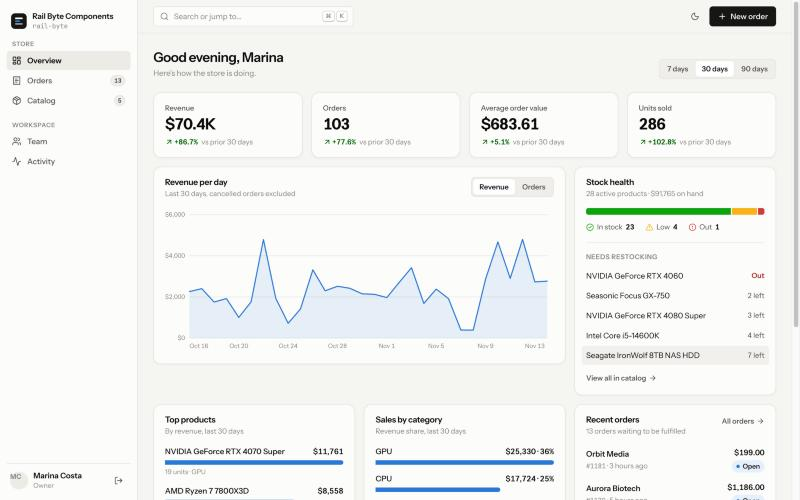
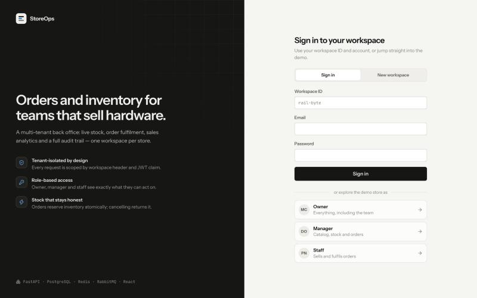
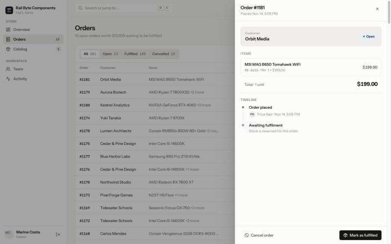
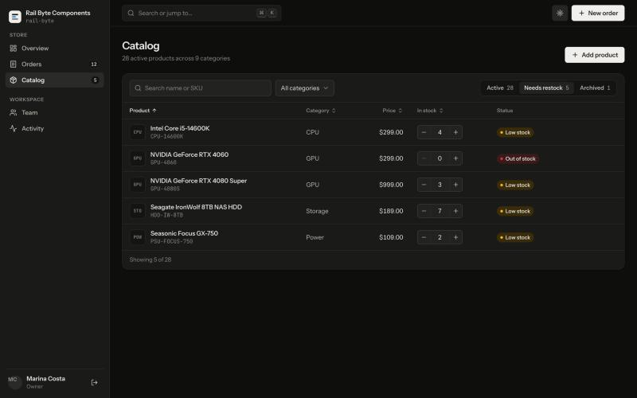

# StoreOps — multi-tenant order & inventory manager

A back office for stores that sell computer hardware: live stock, order
fulfilment, sales analytics, team roles and a full audit trail — one isolated
workspace per store.

**FastAPI · SQLAlchemy 2 (async) · PostgreSQL · Redis · RabbitMQ · React 18 · TypeScript · TanStack Query**



| Sign in | Order detail | Catalog (dark) |
| --- | --- | --- |
|  |  |  |

## Try it in a minute

```bash
./run_mac.sh
```

(Windows: `run_windows.bat`.) The script creates the virtualenv, installs
dependencies, runs migrations, seeds a demo store and starts both servers.
Open [http://localhost:5173](http://localhost:5173) and pick a demo role on the
sign-in screen — no typing needed.

The local run uses SQLite with in-memory stand-ins for Redis and RabbitMQ, so
nothing else has to be installed. For the full stack:

```bash
docker compose up --build
```

| Service | URL |
| --- | --- |
| App | http://localhost:5173 |
| API docs (OpenAPI) | http://localhost:8000/docs |
| RabbitMQ console | http://localhost:15672 (guest / guest) |

### Demo workspace

`rail-byte` is seeded with 29 products, 5 team members and two months of order
history generated relative to today, so the charts are always current.

| Role | Email | Can |
| --- | --- | --- |
| Owner | `owner@railbyte.com` | Everything, including managing the team |
| Manager | `manager@railbyte.com` | Edit catalog and stock, cancel orders, view team and activity |
| Staff | `staff@railbyte.com` | Browse, place and fulfil orders |

Password for all three: `StrongPass123!`. Rebuild the demo data any time with
`python scripts/seed_demo.py --reset` (from `backend/`).

## What it does

- **Overview** — revenue, orders, average order value and units sold, each
  compared with the previous period; daily trend chart; top products; sales by
  category; stock health and a restock list.
- **Orders** — multi-item orders with a point-of-sale style builder, per-store
  order numbers, and a placed → fulfilled / cancelled lifecycle. Cancelling
  returns the units to stock.
- **Catalog** — search, filter and sort; inline stock adjustment; create, edit,
  archive and delete products with low-stock thresholds.
- **Team** — invite members, change roles, deactivate accounts.
- **Activity** — an audit log of every change, grouped by day.
- **Throughout** — command palette (`⌘K` / `Ctrl K`) that searches products,
  orders and actions; light and dark themes; responsive down to phone widths;
  keyboard and screen-reader support.

## How it is built

### Backend (`backend/`)

```text
app/
  api/        HTTP layer — routers and auth/role dependencies
  services/   business rules (orders, inventory, analytics, audit, auth)
  schemas/    Pydantic request/response models
  db/         SQLAlchemy models and session
  core/       config, JWT + password hashing, cache, message publisher
  workers/    RabbitMQ consumer for order events
alembic/      migrations
scripts/      demo seed
tests/        pytest + httpx integration tests
```

Decisions worth a look:

- **Tenant isolation, twice.** Every request names its workspace in an
  `X-Tenant-Slug` header *and* carries a JWT with the tenant claim; a token
  presented against a different workspace is rejected, and every query filters
  by `tenant_id`. (`app/api/deps.py`)
- **Role checks live in the API**, not just the UI: `require_roles(...)` guards
  each write endpoint, and a token whose role claim no longer matches the
  database is refused, so a demotion takes effect immediately.
- **Orders can't oversell.** Placing an order locks the inventory rows
  (`SELECT … FOR UPDATE`, in a stable order to avoid deadlocks), validates
  stock, decrements it and writes the order in one transaction. Order numbers
  come from a per-tenant counter on a locked row. (`app/services/order_service.py`)
- **Audit entries are atomic.** Each change queues its audit record on the same
  transaction, so the log can never disagree with the data.
  (`app/services/audit_service.py`)
- **Rotating refresh tokens.** Refresh tokens are single-use and tracked in
  Redis; logging out revokes them.
- **Read-through cache.** The catalog is cached in Redis and invalidated by
  anything that changes price or stock — including orders and cancellations.
- **Async events.** `order.created` is published to RabbitMQ after commit and
  consumed by a separate worker.
- **Graceful degradation.** With Redis or RabbitMQ unavailable the app falls
  back to an in-process cache and skips publishing, which is what makes the
  zero-dependency local run possible.

### Frontend (`frontend/`)

```text
src/
  api/         typed client: tenant headers, token refresh, error mapping
  hooks/       TanStack Query hooks (queries + mutations), theme
  context/     auth session
  components/  ui primitives (button, drawer, toast, …) and SVG charts
  features/    product drawer, order drawer, cart reducer
  layout/      app shell, navigation, command palette
  pages/       one file per route
  styles/      design tokens + component, layout and page styles
```

- **Silent session renewal.** A 401 triggers one token refresh shared by every
  in-flight request, then each request retries once. (`src/api/client.ts`)
- **Server state with TanStack Query**, keyed by tenant; stock edits update
  optimistically and roll back on failure.
- **No UI framework.** Components and charts are hand-built on CSS custom
  properties; drawers and dialogs use the native `<dialog>` element for focus
  trapping and Escape handling.
- **Charts are accessible**: one hue for magnitude, status colours always paired
  with an icon and label, a keyboard-driven crosshair, and a data table for
  screen readers.
- **Same-origin in development** — Vite proxies `/api` to the backend, so there
  is no CORS setup to get wrong.

## API at a glance

All routes are under `/api/v1` and documented interactively at `/docs`.

| Area | Endpoints |
| --- | --- |
| Auth | `POST /auth/register` · `POST /auth/login` · `POST /auth/refresh` · `POST /auth/logout` · `GET /auth/me` |
| Team | `GET /auth/users` · `POST /auth/users` · `PATCH /auth/users/{id}` |
| Catalog | `GET/POST /products` · `GET/PUT/DELETE /products/{id}` · `GET /products/categories` |
| Inventory | `GET/PUT /inventory/{product_id}` |
| Orders | `GET/POST /orders` · `GET /orders/{id}` · `POST /orders/{id}/fulfill` · `POST /orders/{id}/cancel` |
| Analytics | `GET /analytics/summary?days=30` |
| Audit | `GET /audit-logs` |

## Running the pieces yourself

```bash
# backend
cd backend
python -m venv .venv && source .venv/bin/activate   # Windows: .venv\Scripts\activate
pip install -r requirements.txt
cp .env.example .env        # then point DATABASE_URL at SQLite or Postgres
alembic upgrade head
python scripts/seed_demo.py
uvicorn app.main:app --reload
```

For a dependency-free `.env`:

```ini
DATABASE_URL=sqlite+aiosqlite:///./dev.db
REDIS_ENABLED=false
RABBITMQ_ENABLED=false
SECRET_KEY=change-me
```

```bash
# frontend
cd frontend
npm install
npm run dev
```

## Tests

```bash
cd backend && pytest          # API integration tests against SQLite
cd frontend && npm test       # unit and component tests (Vitest)
cd frontend && npm run build  # type-check + production build
```

The backend suite covers tenant isolation, role enforcement, stock
reservation and restocking, order numbering, analytics maths, the audit log
and token rotation. The frontend suite covers the API client (including
concurrent token refresh), the cart reducer, formatters, chart scales and
component behaviour.

## Migrations

| Revision | Change |
| --- | --- |
| `20260422_0001` | Initial schema |
| `20260422_0002` | Audit log table |
| `20261114_0003` | Product categories, order numbers and customer names, member names |

```bash
cd backend
alembic revision -m "describe the change"
```

## Notes

- `docker-compose.yml` uses development credentials and a placeholder
  `SECRET_KEY`; replace them before deploying anywhere real.
- Analytics are aggregated in Python for portability between SQLite and
  PostgreSQL. That is fine at demo scale; a production version would push the
  aggregation into SQL.
